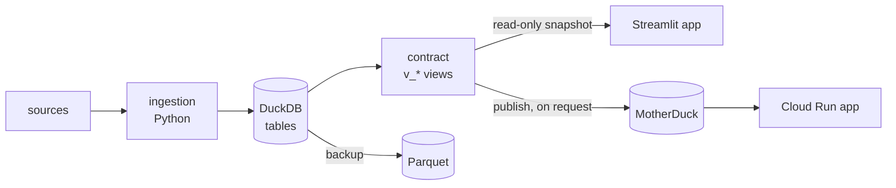

# duckviz-scaffold

A scaffold for creating personal apps centred on data analysis and data visualisation. It gives every app the same
standard structure, so you can start new apps quickly and keep existing ones current as the scaffold evolves. Each
app:

1. **ingests** data with Python (files, an API, a device) into **one DuckDB file** on your machine;
2. offers it through a **versioned SQL contract**: a few `v_*` views, with a reference schema and a conformance
   check;
3. shows it in a **Streamlit app that reads only the contract**, never the tables.

Optional parts:
- **MotherDuck** publishing, so a hosted app or Claude can read the contract from anywhere;
- **Cloud Run** hosting behind Google sign-in;
- **Tailscale** serving to your own devices;
- verified **Parquet backups**;
- a **privacy check** that keeps personal data out of git;
- **Claude Code** skills for the everyday tasks.



## Two parts, one release

| Part | What it is | How an app uses it |
|---|---|---|
| [`kit/`](kit) | **duckkit**: the Python code every app shares. It covers the contract check, snapshots, publish, backups, the privacy check, serving, the standard CLI commands, Streamlit helpers and the test guards. | a dependency, pinned to the release tag |
| [`template/`](template) + [`copier.yml`](copier.yml) | a **[Copier](https://copier.readthedocs.io) template**: the repo layout, CI, Dockerfile, CLAUDE.md, docs, skills and an example app | `copier copy` once, then `copier update` for each release |

The two release together under one `vX.Y.Z` tag, so an app's files and its duckkit always match. Each app keeps
only its own code: what it ingests, its tables, its contract views and its pages.

## Documentation

| Read | To learn |
|---|---|
| [docs/architecture.md](docs/architecture.md) | how an app made from the scaffold works: the two sides, the contract, the database, the browser app, where it runs, the CLI, settings and privacy, backups, the repo layout |
| [docs/kit.md](docs/kit.md) | every duckkit module: what it is for, its functions, which command uses it, and the hooks where an app plugs in its domain |
| [docs/template.md](docs/template.md) | the template: every answer and option and what it decides, options vs capabilities, which files it manages and which it seeds once, deviations |
| [docs/upgrading.md](docs/upgrading.md) | the update cycle in detail, and adopting the scaffold in an existing repo |
| [docs/how-we-work.md](docs/how-we-work.md) | how apps and this repo are developed: outcomes, the spec, the PRs Claude merges, what waits for the user |
| [docs/review.md](docs/review.md) | the review standards for every change, with a bad and a good example of each |
| [CHANGELOG.md](CHANGELOG.md) | what each release adds, and the steps an app must take by hand |

## Start a new app

You need [uv](https://docs.astral.sh/uv/) and git. One command makes the app, and the rest checks it works:

```sh
uvx copier copy --trust gh:battlehorse/duckviz-scaffold my-app
cd my-app && git init -b main && uv sync && uv run pytest -q
printf 'day,value\n2026-01-01,3\n' > sample.csv
uv run my-app ingest sample.csv    # the example app ingests day,value CSV files
uv run my-app app                  # http://localhost:<port>
```

The new app is a working example: a small `day,value` ingestion, its contract and a dashboard. You replace the
example with your own data (see [Develop an app](#develop-an-app)).

### What Copier asks

1. **Names and values:** the project's name (the repo and the command), the Python package, a one-line description,
   the browser app's title, the contract's name, the time zone, the port on localhost, and more browser apps if the
   app has several.
2. **Options:** the features below, each a yes or no.
3. **Opt-outs:** template files the app doesn't want (usually none).

The answers go in the app's `.copier-answers.yml`, and `copier update` reuses them. docs/template.md explains each
answer and option, and the rule for what may be an option at all.

### What every app has

There is no question for these. Every app gets:
- **the contract** (`v_*` views, a reference schema, a conformance check) and the guard test that the browser app
  reads only the contract;
- **the commands:** the app's own `ingest`, and duckkit's standard ones: `status` (the data and the contract
  check), `sql` (one read-only `SELECT`), `app` (serve the browser app, `--tailnet` for your own devices), `doctor`
  (is the app in step with the scaffold), `privacy-check`, and `spec-diff` (what a branch changes in the spec);
- **settings in `config.toml`**, kept out of git, and a pre-commit hook that runs `privacy-check`;
- **CI**, and a weekly workflow that opens a PR when a new scaffold release is out;
- **the Claude Code setup:** CLAUDE.md, skills for the everyday tasks (`/ingest`, `/ask`, `/app`, `/app-check`,
  `/catch-up`, `/scaffold-update`, `/deliver-outcome`), the `reviewer` agent, and the prompts before a hard stop;
- **the spec's docs:** architecture, contract, dashboard, browser checks, `docs/spec.md`.

### Optional features

| Option | Default | Adds |
|---|---|---|
| `motherduck` | on | `publish` and `/publish`: the contract's views go to MotherDuck, so a hosted app or Claude can read them from anywhere |
| `cloud_run` | off | hosting on Cloud Run behind Google sign-in: the Dockerfile, `/hosting`, docs/hosting.md (needs `motherduck`) |
| `backup` | on | verified Parquet backups: `backup`, `backups`, `restore` and `/backup` |
| `demo_data` | off | a synthetic demo database: `demo`, `app --demo` |
| `curations` | off | decisions kept in `curated/*.csv` in git (categories chosen by hand or by a model), restored into a rebuilt database. The repo must stay private. |

### Opt-outs

An app that truly can't have a capability lists the file in `opt_out` (for example
`[.claude/skills/catch-up/SKILL.md]`). Copier then never writes it. The app says why in `docs/deviations.md`, and
`doctor` checks that every opt-out is explained there. Opt out rarely: a file that several apps opt out of is a sign
that the scaffold should change.

## Develop an app

The scaffold and its apps are made for agentic development with [Claude Code](https://claude.com/claude-code). You
set **outcomes**, and Claude does the work, in PRs. [docs/how-we-work.md](docs/how-we-work.md) is the canonical
description:
- **Outcomes.** You open a GitHub issue with the label `outcome`, in one or two sentences ("replace the example with
  my bank's CSV exports", say). `/deliver-outcome` takes it from there: Claude posts a brief, you approve it, and
  Claude works on its own until it posts a report with the evidence.
- **The spec.** Each app's `docs/spec.md` lists what only you approve: what the app is for, how it is built, its
  data contract, its behaviour (browser checks, real-data tests, spec tests) and its guardrails. Claude merges a PR
  that leaves the spec unchanged, after CI and an independent review. A PR that changes the spec waits for you.
- **The hard stops.** An action that cannot be undone, such as publishing, deploying or deleting data, needs your
  yes first.

The first outcome of a new app is usually to replace the example with its own data: the sources in `ingest/`, the
tables and views in `db/schema.sql`, the contract in `contract/schema.sql` and `docs/contract.md`, and the pages in
`app/views/`. docs/architecture.md says what each file is for.

## Keep apps current

```
discover (in an app) → upstream (here: /upstream) → release (scripts/release.py) → apply (in each app: /scaffold-update)
```

1. **Discover.** While working in an app, you build something every app could use.
2. **Upstream.** In this repo, the `/upstream` skill moves it here: code into duckkit, made general through the
   spec or a hook, and files into the template. A capability goes to every app. It becomes an option only when
   docs/template.md's rule allows. Tests and a CHANGELOG entry come with it.
3. **Release.** `scripts/release.py` sets the version on a branch for a PR. After the merge, `--tag` tags it.
4. **Apply.** Each app gets a PR from its weekly `scaffold-update` workflow, or you run `/scaffold-update`. Copier
   merges the new files 3-way and keeps the app's own edits. `doctor` then checks that the app is in step.

An app can differ on purpose: an option turned off, a file in `opt_out`, or an edit to a managed file. It lists each
difference in its `docs/deviations.md`, and `doctor` checks that the opt-outs are explained there.

## Repository layout

```
kit/                     duckkit (src/duckkit/) and its tests
template/                the Copier template: the app's files, rendered with the answers
copier.yml               the questions (answers and options), and which files are seeded once
docs/                    architecture, kit, template, upgrading; how-we-work and review (links to template/docs/)
scripts/render.sh        renders a sample app with every option on and one with every option off, and tests both
scripts/release.py       sets the release version (on a branch), then tags it (on main)
.claude/skills/upstream  the skill that brings a capability from an app into the scaffold
.github/workflows/ci.yml the kit's tests and the two sample apps, on every PR
```

## Development

```sh
cd kit && uv sync && uv run pytest -q && uv run ruff check .
scripts/render.sh
```

Every change goes through a PR. CLAUDE.md has the rules for working on this repo.
