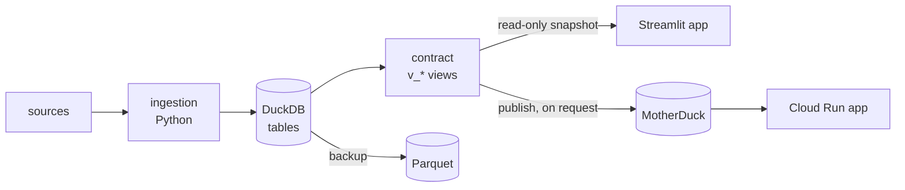

# duckviz-scaffold

A starting point, and a way to keep it current, for personal apps centred on data analysis and data
visualisation. Each app:

1. **ingests** data with Python (files, an API, a device) into **one DuckDB file** on your machine;
2. offers it through a **versioned SQL contract**: a few `v_*` views, with a reference schema and a conformance
   check;
3. shows it in a **Streamlit app that reads only the contract**, never the tables.

Optional parts:
- **MotherDuck** publishing, so a hosted app or Claude can read the contract from anywhere;
- **Cloud Run** hosting behind Google sign-in;
- **Tailscale** serving to your own devices;
- verified **Parquet backups**;
- a **privacy check** that keeps personal data out of git;
- **Claude Code** skills for the everyday tasks.



## Two parts, one release

| Part | What it is | How an app uses it |
|---|---|---|
| [`kit/`](kit) | **duckkit**: the Python code every app shares. It covers the contract check, snapshots, publish, backups, the privacy check, serving, the standard CLI commands, Streamlit helpers and the test guards. | a dependency, pinned to the release tag |
| [`template/`](template) + [`copier.yml`](copier.yml) | a **[Copier](https://copier.readthedocs.io) template**: the repo layout, CI, Dockerfile, CLAUDE.md, docs, skills and an example app | `copier copy` once, then `copier update` for each release |

The two release together under one `vX.Y.Z` tag, so an app's files and its duckkit always match. Each app keeps
only its own code: what it ingests, its tables, its contract views and its pages.

## Documentation

| Read | To learn |
|---|---|
| [docs/architecture.md](docs/architecture.md) | how an app made from the scaffold works: the two sides, the contract, the database, the browser app, where it runs, the CLI, settings and privacy, backups, the repo layout |
| [docs/kit.md](docs/kit.md) | every duckkit module: what it is for, its functions, which command uses it, and the hooks where an app plugs in its domain |
| [docs/template.md](docs/template.md) | the template: every answer and option and what it decides, options vs capabilities, which files it manages and which it seeds once, deviations |
| [docs/upgrading.md](docs/upgrading.md) | the update cycle in detail, and adopting the scaffold in an existing repo |
| [CHANGELOG.md](CHANGELOG.md) | what each release adds, and the steps an app must take by hand |

## Start a new app

You need [uv](https://docs.astral.sh/uv/) and git.

```sh
uvx copier copy --trust gh:battlehorse/duckviz-scaffold my-app
cd my-app && git init -b main && uv sync && uv run pytest -q
printf 'day,value\n2026-01-01,3\n' > sample.csv
uv run my-app ingest sample.csv    # the example app ingests day,value CSV files
uv run my-app app                  # http://localhost:<port>
```

Copier asks for the app's names and values (name, package, port, contract name, time zone, more apps) and four
options. The answers go in the app's `.copier-answers.yml`, and `copier update` reuses them.

Every app has these capabilities: the contract and its guard, `status`, `sql`, `doctor`, settings in `config.toml`,
`privacy-check` with its pre-commit hook, `app --tailnet`, CI and the Claude Code skills. The options are where
apps truly differ:

| Option | Default | Adds |
|---|---|---|
| `motherduck` | on | `publish` and `/publish`: the contract's views may leave the machine |
| `cloud_run` | off | the Dockerfile, `/hosting`, docs/hosting.md, the idle pause (needs `motherduck`) |
| `backup` | on | `backup`, `backups`, `restore` and `/backup` |
| `demo_data` | off | `app --demo` on `data/demo.duckdb` |
| `curations` | off | decisions kept in `curated/*.csv` in git, restored into a rebuilt database (the repo stays private) |

docs/template.md explains each answer and option, and the rule for what may be an option at all.

The first thing to do is replace the example. Write your sources in `ingest/`, your tables and views in
`db/schema.sql`, your contract in `contract/schema.sql` and `docs/contract.md`, and your pages in `app/views/`.
docs/architecture.md says what each file is for.

## Keep apps current

```
discover (in an app) → upstream (here: /upstream) → release (scripts/release.py) → apply (in each app: /scaffold-update)
```

1. **Discover.** While working in an app, you build something every app could use.
2. **Upstream.** In this repo, the `/upstream` skill moves it here: code into duckkit, made general through the
   spec or a hook, and files into the template. A capability goes to every app; an option only when docs/template.md's rule allows. Tests and a
   CHANGELOG entry come with it.
3. **Release.** `scripts/release.py` sets the version on a branch for a PR. After the merge, `--tag` tags it.
4. **Apply.** Each app gets a PR from its weekly `scaffold-update` workflow, or you run `/scaffold-update`. Copier
   merges the new files 3-way and keeps the app's own edits. `doctor` then checks that the app is in step.

An app can differ on purpose: an option turned off, a file in `opt_out`, or an edit to a managed file. It lists each
difference in its `docs/deviations.md`, and `doctor` checks that the opt-outs are explained there.

## Repository layout

```
kit/                     duckkit (src/duckkit/) and its tests
template/                the Copier template: the app's files, rendered with the answers
copier.yml               the questions (answers and options), and which files are seeded once
docs/                    architecture, kit, template, upgrading
scripts/render.sh        renders a sample app with every option on and one with every option off, and tests both
scripts/release.py       sets the release version (on a branch), then tags it (on main)
.claude/skills/upstream  the skill that brings a capability from an app into the scaffold
.github/workflows/ci.yml the kit's tests and the two sample apps, on every PR
```

## Development

```sh
cd kit && uv sync && uv run pytest -q && uv run ruff check .
scripts/render.sh
```

Every change goes through a PR. CLAUDE.md has the rules for working on this repo.
