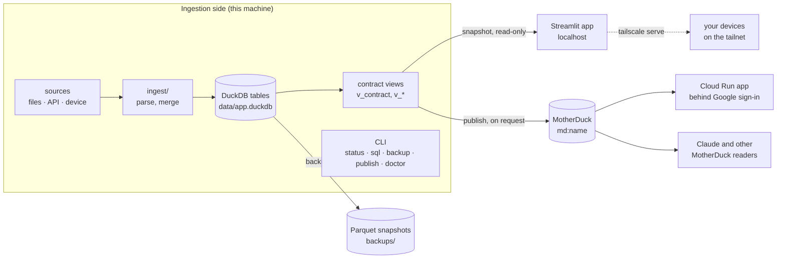
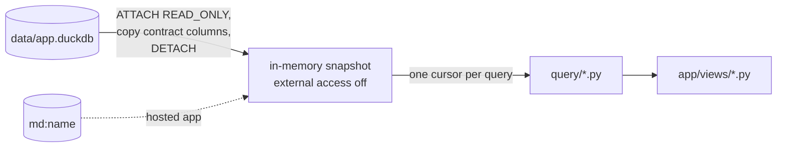
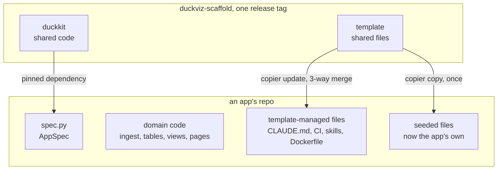

# Architecture of an app made from the scaffold

Every app made from duckviz-scaffold has the same shape. It reads data from somewhere (files, an API, a device),
keeps it in one DuckDB file on this machine, and shows it in a Streamlit app. Between the two sits a **data
contract**: a small, versioned set of SQL views. The app reads those views and nothing else.

This page describes that shape. docs/kit.md describes the shared code module by module, and docs/template.md the
files the template writes.

## The big picture



An app has two sides:

- **The ingestion side** owns the database. It reads the sources, merges them into tables, and defines the
  contract's views over those tables. The CLI belongs to this side: it opens the database for writing, makes
  backups and publishes.
- **The browser side** is the Streamlit app. It never opens the database file. It gets an in-memory copy of the
  contract's views (a *snapshot*) and runs its queries on that copy.

The contract is the only thing the two sides share. The ingestion can rename, split or rebuild its tables freely,
as long as the views keep their promised shape. The app can be tested, hosted and published without any of the
ingestion's code or data.

## The data contract

The contract has three parts, all in the app's `src/<package>/contract/` and `docs/contract.md`:

| Part | Where | What it is |
|---|---|---|
| Reference schema | `contract/schema.sql` | Each view written as a `CREATE TABLE` of the same name: columns, types, `PRIMARY KEY`, `NOT NULL`. The comments describe each view and column. |
| Name, version and rules | `contract/__init__.py` | `CONTRACT = Contract(name, version, schema, rules)`. Rules are SQL that counts the rows breaking a promise, such as "no negative values" or "every category exists". |
| The views themselves | `db/schema.sql` | `CREATE OR REPLACE VIEW v_* AS …` over the ingestion's tables. |
| Documentation | `docs/contract.md` | One section per view, listing its columns in order. A test checks it against the schema. |

`v_contract` is always present and has one row with the contract's name and version, such as `shop 1.2`.

- A **minor** version only adds: a new view or a new column.
- A **major** version renames or removes something.
- A reader accepts any database with the same name and major version. So an app built for 1.2 can read a
  database at 1.4, and refuses one at 2.0 with a clear message.

`Contract.check(con)` compares a database with the reference schema. It returns one message per problem:

- a missing view or column, or a column of the wrong type;
- a duplicate primary key, or a NULL in a `NOT NULL` column;
- a broken rule, or a problem found by a custom check;
- a wrong version.

`status` and `ingest` print the result. An empty list means the database conforms.

## The database

There is one DuckDB file, `data/<db_file>`. `<PREFIX>_DB` points somewhere else.

- `db/schema.sql` runs on every write connection. It creates only what is missing (`CREATE TABLE IF NOT EXISTS`)
  and replaces the views. So a change to a view needs no migration, but a change to a table does.
- `db/store.py` holds `SCHEMA_VERSION` and `MIGRATIONS`, which map a version to the SQL or function that brings it
  to the next one. The database records its version in `schema_version`. duckkit runs the missing migrations in
  turn. It refuses a database newer than the code, and it refuses one that has no path forward.
- No code drops a table. The database may hold data that can't be fetched again, for example when a source keeps
  only recent data. A migration that drops a table is written and reviewed in the app.
- DuckDB stays at 1.5.x. MotherDuck does not support 2.0 yet, and a 2.0 file can't be opened by 1.x.

## The browser app



- **One snapshot per process.** `duckkit.app.common.load_contract_snapshot` attaches the database read-only,
  checks the contract version, and copies each view into memory, keeping only the reference schema's columns.
  Then it detaches. No lock is held, so `ingest` can run while the app is open. File access is switched off in
  the copy, so a query can't read or write files. Every Streamlit session shares the snapshot, and each query
  gets its own cursor.
- **Reload data** in the sidebar throws the snapshot away, and the next run takes a new one.
- **Pages** live in `app/views/`, registered in `app/main.py` with `st.navigation`. **Queries** live in `query/`.
  Each is a function of a cursor that returns a DataFrame. Pure calculations go in `analysis.py`.
- **A hosted app** reads the published copy in MotherDuck instead (`<PREFIX>_APP_DB=md:<name>`). The code doesn't
  change: `contract_snapshot` accepts a file or `md:`.
- **Charts** use the shared palettes in `duckkit.app.theme`, follow the viewer's light or dark theme
  (`watch_theme`), and have a table view beside them.

### The boundary is tested

`tests/app/test_contract_only.py` comes from the template, and the template keeps it current. It calls
`duckkit.testing.guard`, which fails the build when the browser app's code (`spec.app_code`):

- has a SQL string that names anything other than a contract view, or a column the contract doesn't have. Each
  query is parsed by DuckDB and run against the reference schema.
- imports the ingestion side: the modules in `spec.forbidden` (`ingest`, `db`, `cli`, …), or duckkit's service
  modules (`store`, `backup`, `privacy`, `publish`, `cli`, `doctor`, `serve`, `demo`, `curated`, `specdiff`,
  `llm`). This is checked in the source and again by importing the app in a fresh interpreter, which catches
  imports made indirectly.

The app's tests (`tests/app/`) build their databases from the reference schema
(`duckkit.testing.contract_db`), with synthetic rows from `tests/app/contract_data.py`. They never run the
ingestion.

## Where it runs

| Mode | Command | Reads | Who can open it |
|---|---|---|---|
| Local | `<cli> app` | `data/<db_file>` | this machine (`localhost:<port>`) |
| Demo | `<cli> app --demo` | `data/demo.duckdb` | this machine: for screenshots and demos without real data |
| Tailnet | `<cli> app --tailnet` | `data/<db_file>` | your devices on Tailscale, over HTTPS, while the command runs |
| Hosted | Cloud Run (`/hosting deploy`) | `md:<name>`, through a read-only token | the people you allow, through Google sign-in (IAP) |

- Streamlit always listens on localhost, sends no usage statistics and shows no Deploy button.
- `--tailnet` adds a foreground `tailscale serve` that ends with the app. `tailscale funnel`, which would publish
  to the internet, is never used.
- The Cloud Run image has only the code: `.dockerignore` keeps out `data/`, the settings and the backups. The image
  scales to zero, and an idle tab goes to a static "Paused" page so the instance can stop.

An app can have more than one Streamlit app (`extra_apps`), for example a curation tool. A `hosted: false` app may
read the whole database (`database_snapshot`), and the browser app may never import it. Only the browser app (`app`)
goes to Cloud Run: an extra app runs on this machine, whatever its `hosted` flag.

## The command line

`src/<package>/cli.py` is a [Typer](https://typer.tiangolo.com) app. Typer is a Python library that builds a
command line from plain functions: each function becomes a command, its parameters become arguments and options,
and its docstring becomes the `--help` text. `cli.py` holds the app's own commands, such as `ingest`, and then
calls `duckkit.cli.add_standard_commands`, which adds the commands every app has:

| Command | What it does |
|---|---|
| `status [--remote]` | the app's own summary lines, the backups line, then the contract check. `--remote` adds whether the published copy and the hosted app are current, and how old the newest off-machine backup is |
| `sql "SELECT …"` | one read-only query on a snapshot of the whole database |
| `publish [--to] [--dry-run] [--check]` | send the contract's views to MotherDuck; show what would go; compare the published copy |
| `backup`, `backups`, `restore` | verified Parquet snapshots of the whole database, also in Cloud Storage with `[backup] remote` |
| `fetch-backup [snapshot]` | bring a snapshot back from Cloud Storage into the backup folder, checked |
| `app [name] [--tailnet] [--demo]` | serve a Streamlit app |
| `privacy-check` | fail when a file git would commit contains personal data |
| `doctor [--remote]` | compare the repo with the scaffold release it comes from. `--remote` also asks GitHub whether a newer release is out, whether a repo that holds `curated/` is public, and whether the backup bucket is private. |
| `spec-diff [--base]` | list what a branch changes in the app's spec (docs/how-we-work.md) |
| `curated-check [--base]` | show what a commit does to the curated files, and fail on a large loss (the `curations` option) |

The template writes `docs/cli.md` for each app, and the Claude Code skills (docs/skills.md) run these commands.

## Settings, secrets and personal data

- **Settings** live in `config.toml` (`[section] key`). It is gitignored, and the template writes a
  `config.example.toml` beside it. They are read through `SPEC.setting(section, key, env, default)`. An
  environment variable overrides the file, which is how CI, tests and Cloud Run (whose secrets arrive as
  variables) set them. Then comes the default.
- **Personal data never goes into git.** That covers secrets, addresses, names, readings and screenshots of real
  data. `privacy-check` scans every file git would commit for:
  - the values of `spec.private_settings`, the MotherDuck token and the Anthropic API key;
  - the terms under `[privacy] terms`;
  - the app's own terms, such as names found in its database.

  The pre-commit hook in `.githooks/` runs it before every commit. Tests and docs use synthetic data only.
- **Only `publish` sends data out**, and only the contract's views. It never runs on its own: only the command, or
  `/publish` after showing what will leave.

## Backups

`backup` exports the whole database with `EXPORT DATABASE` as Parquet, which any tool can read and which doesn't
depend on the DuckDB version. Each export goes into its own folder in `backups/` (or `[backup] dir`). The export
is then imported into memory and compared with the source, table by table, by row count and a hash of the
contents. Only the newest 30 are kept. `restore` builds a new database file from a snapshot and never overwrites
an existing one. `status` shows how old the newest backup is.

**Off the machine.** With `[backup] remote = "gs://<bucket>"` in `config.toml`, `backup` also copies each verified
snapshot, byte for byte, to Google Cloud Storage at `gs://<bucket>/<package>/<snapshot>/`, with `gcloud storage`
and the user's own login. `load.sql` goes up last, and each file's MD5 must match the local one. A failed copy
keeps the local snapshot and exits 1. The newest `keep` stay there too. `backups` lists both sides, and
`fetch-backup` brings a snapshot to a new machine, checked, for `restore`. `status --remote` shows how old the
newest copy there is, and `doctor --remote` checks that the bucket is private: a snapshot holds the whole database.

## Curated decisions (the `curations` option)

The decisions that people, or a model, make about the data, and that the sources can't give back: a product's
category, a merchant's name, a day's label. They cost time or money to make.

- **Source of truth: the database**, in the curated tables, next to the data they describe. The app, the commands
  and every query read them there.
- **Backup: `curated/*.csv`, committed to git.** One file per curated table, sorted, so a git diff shows each
  changed decision. The files are the user's decisions, so a repo with curations stays private (`doctor --remote`
  checks).
- **Write path: after each command that changes a decision.** Every such command runs inside `curating()`, which
  exports the curated tables to the files after the command, and after a failure too (earlier batches may have
  committed). The command can't forget it. Don't edit the files by hand: the next command overwrites the edit.
- **Read path: only when the database is rebuilt** (lost, a new clone, a schema change with no migration). The
  `ingest` that rebuilds it calls `restore`, which loads the files into the empty curated tables. Nothing else reads
  them.
- **Matching: by key.** The ingestion computes each row's key from the raw data, for example a SKU key from a
  product's name. A new row whose key already has a decision gets it at once, because the views join on the key. A
  new key has no decision until a command, or a model, makes one.
- **Guardrails against accidental loss:**
  - A database that holds no decisions (rebuilt, and not restored yet) never overwrites files that hold some.
  - The pre-commit hook runs `curated-check`. It lists what each commit does to each file, and stops one that
    empties a file or loses many rows until the user confirms (`ALLOW_CURATED_LOSS=1`).
  - Git keeps every version. To recover lost decisions, `git checkout HEAD -- curated/` restores the files. Then
    rebuild the database (`/rebuild-database`), with any missing sources back, so that it holds them too.
  - `curating()` refuses a demo database: its made-up decisions must never reach the files.

duckkit's functions are in docs/kit.md (`duckkit.curated`).

## Code: duckkit, the template, the app



Each piece of an app is one of three kinds:

| Kind | Examples | Changes through |
|---|---|---|
| **duckkit**, the same in every app | snapshots, contract check, publish, backups, privacy, serving, standard commands, test guard | a new duckkit version (`pyproject.toml`) |
| **Template-managed files**, shared but editable | CLAUDE.md, CI, Dockerfile, generic skills, `docs/cli.md` | `copier update`, which keeps the app's edits |
| **App-owned files**, seeded once | `spec.py`, ingest, `db/schema.sql`, the contract, pages, `docs/contract.md` | the app alone |

duckkit knows nothing about any app. Each app describes itself once in `src/<package>/spec.py`, as an `AppSpec`:
its package name, paths, ports, contract, settings and forbidden modules. Every duckkit function takes that spec.
The app's domain plugs in through hooks:

- contract rules and checks;
- the `status` lines;
- privacy terms;
- the schema and its migrations;
- its own page helpers.

## An app's repo

```
src/<package>/
  spec.py              the AppSpec: the one description duckkit reads
  cli.py               the app's commands + add_standard_commands
  ingest/              reading the sources (pipeline.py: one transaction per source, each run logged)
  db/schema.sql        the tables, then the contract views
  db/store.py          SCHEMA_VERSION, MIGRATIONS, connect()
  contract/schema.sql  the reference schema
  contract/__init__.py CONTRACT: name, version, rules
  query/               the app's queries, on the views only
  app/main.py          the Streamlit entry point and navigation
  app/views/           one file per page; dashboard.py is the landing page
  app/common.py        duckkit's snapshot and sidebar, bound to this spec
  app/static/          paused.html (hosted apps)
tests/                 the ingestion's tests (synthetic data in tests/data/)
tests/app/             the browser app's tests, on contract databases
  test_contract_only.py  the boundary guard (template-managed)
docs/                  architecture, contract, dashboard, cli, getting-started, scaffold, deviations, hosting
.claude/               project-rules.md (the app's rules) and skills/
.copier-answers.yml    the scaffold release and answers this repo was made with
data/, backups/        gitignored: the database and its snapshots
```

## Working with Claude Code

Each app's `CLAUDE.md` is template-managed. It holds the rules every app shares:

- the contract boundary, and never dropping a table;
- personal data stays out of git, and publishing happens only on request;
- every change goes on a branch and through a PR;
- shared code goes upstream to the scaffold.

It imports `.claude/project-rules.md`, which holds the app's own rules, so the two never conflict on update.

The skills turn the CLI into tasks, such as `/ingest`, `/ask` and `/app`. docs/skills.md lists each skill that the
template writes, and the option that adds it.
